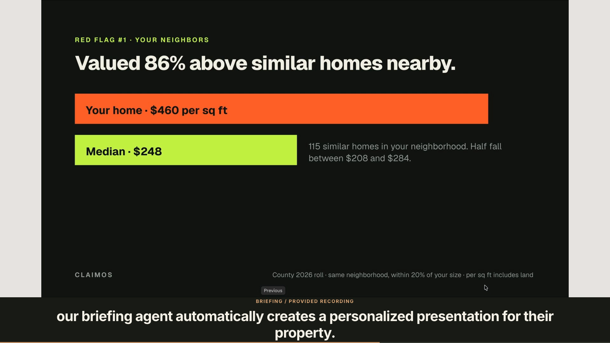

# Claim OS · 90-second demo

A cinematic walkthrough of the agent-run property-tax company: Find, Qualify, outreach, voice-signature preview, petition preparation, Chase, the website’s personalized presentation feature, and the success-fee model through Stripe.

- [Download the video](claimos-demo-90s.mp4?raw=true)
- [Presenter script](presenter-script.txt)
- [Timed presenter script](presenter-script.md)
- [SRT subtitles](subtitles.srt) · [WebVTT subtitles](subtitles.vtt)

The video is exactly **90 seconds**, **1920×1080**, **30 fps**, and silent for live narration. Its subtitles match the presenter script.

The revenue model is a success fee only when the owner wins and the tax bill decreases: **30% of verified savings, invoiced through Stripe**. The video distinguishes recorded outreach and supplied presentation footage from the illustrated filing and payment scenario using a small Demo scenario marker.

Download this folder and open `index.html`, or open the MP4 directly.

